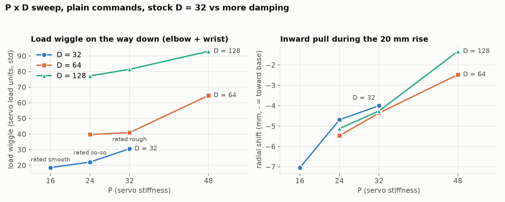

# P × D sweep (automated, telemetry)

`tmp_scripts/pd_sweep.py`, firmware with T:116/117/118. Plain commands (no compensation), servo acceleration limit off, gains on base + shoulder (both servos) + elbow + wrist. Each trial: down 20 mm, up 20 mm, 30 mm to the arm's left, back, from the ready pose (x=180, z=−40, gripper down). Telemetry ~95 samples/s.

| P | D | rated by eye (2026-10-11) | load wiggle down, elbow + wrist | elbow speed sign flips down | inward shift during rise (mm) | below target after rise (mm) |
|---|---|---|---|---|---|---|
| 16 | 32 | smooth (4–5) | 17.6 | 0 | −7.4 | −14.4 |
| 24 | 32 | so-so (2–3) | 22.0 | 0 | −4.7 | −11.3 |
| 24 | 64 | | 39.8 | 8 | −5.5 | −11.1 |
| 24 | 128 | | 77.2 | 10 | −5.1 | −11.2 |
| 32 | 32 | rough (1–2) | 30.6 | 2 | −4.0 | −9.5 |
| 32 | 64 | | 40.9 | 4 | −4.4 | −9.5 |
| 32 | 128 | | 81.4 | 6 | −4.3 | −9.5 |
| 48 | 64 | | 64.7 | 10 | −2.5 | −7.1 |
| 48 | 128 | | 93.0 | 13 | −1.3 | −7.4 |
| 16 | 32 | (repeat) | 19.5 | 0 | −6.7 | −14.6 |

## Findings

- **Load wiggle tracks the eye ratings** (smooth 17.6 → so-so 22.0 → rough 30.6), so it's a usable automatic smoothness score. Joint-position wiggle didn't separate them (0.49 / 0.54 / 0.68 counts): the roughness you see is mostly below one encoder step or faster than the ~47 Hz the telemetry can resolve.
- **More damping makes it worse.** At every P, D = 128 roughly triples to quadruples the load wiggle and adds speed reversals. Most likely D is amplifying the 12-bit encoder's step-to-step jumps. So D can't buy smooth motion at higher P.
- **Stiffness reduces the inward drift** (−7.4 mm at P = 16 → −1.3 mm at P = 48 with D = 128) but costs smoothness.
- **Inward movement is a rise problem.** The sideways moves themselves shift the tip radially by only −0.5 to +2.5 mm; the rest is carried over from the rise.
- Repeatable: the closing stock trial matched the opening one (19.5 vs 17.6, −6.7 vs −7.4 mm).

Conclusion: keep stock gains (P 16, D 32) and fix the drift with feedforward → see `../143713_comp_check/`.

Files: `summary.json` (all per-move numbers), `trials/*.npz` (raw telemetry + commanded path), `run.log`.
