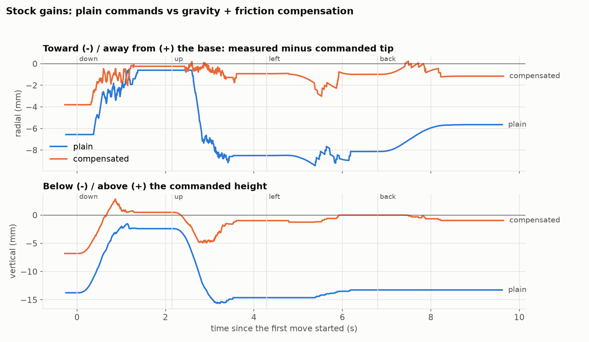

# Does compensation stop the inward drift?

`tmp_scripts/comp_check.py`, stock gains (P 16, D 32). Same moves and telemetry analysis as the P × D sweep, alternating plain commands and the gravity + friction feedforward in `roarm/tuning.json` (fitted 2026-10-11, `friction_tune.py` v2). Two rounds each.

| | inward shift during rise | after rise: radial / vertical | after return from the left: radial / sideways / vertical |
|---|---|---|---|
| plain, round 1 | −7.9 mm | −8.5 / −14.6 mm | −5.7 / 4.0 / −13.3 mm |
| plain, round 2 | −6.6 mm | −8.4 / −14.6 mm | −8.8 / 2.6 / −13.0 mm |
| **compensated, round 1** | **−0.7 mm** | **−0.9 / −1.0 mm** | **−1.2 / 1.9 / −1.0 mm** |
| **compensated, round 2** | **−0.2 mm** | **−0.8 / −1.2 mm** | **−0.8 / 1.9 / −0.8 mm** |

## Findings

- The compensation removes almost all of the inward pull when rising (−7 mm → under 1 mm) and the 14.6 mm vertical shortfall (→ ~1 mm), at the smooth stock gains.
- What's left is mostly ~1.9 mm **sideways** after returning from the left, and ~2–3 mm brief dips while moving left. The base's friction term doesn't fully cancel its friction yet; that's the next thing to improve.

Files: `summary.json`, `trials/*.npz` (raw telemetry + target path).
