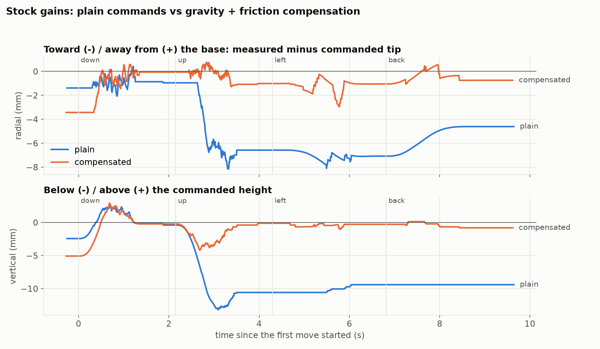

# Does compensation stop the inward drift? (shoulder trim on, refitted model)

`tmp_scripts/comp_check.py`, stock gains (P 16, D 32), shoulder trim 41, compensation from `../223652_friction_refit/`. Same moves and telemetry analysis as `../143713_comp_check/` (old model, no trim): down 20, up 20, 30 mm left, back. Two rounds each, alternating plain and compensated.

| | inward shift during rise | after rise: radial / vertical | after return from the left: radial / sideways / vertical |
|---|---|---|---|
| plain, round 1 | −5.6 mm | −6.6 / −10.6 mm | −4.6 / 3.8 / −9.4 mm |
| plain, round 2 | −6.9 mm | −7.7 / −10.8 mm | −4.6 / 3.8 / −9.4 mm |
| **compensated, round 1** | **−1.0 mm** | **−1.0 / −0.1 mm** | **−0.7 / 0.8 / −0.8 mm** |
| **compensated, round 2** | **−1.4 mm** | **−1.4 / −0.6 mm** | **−0.7 / 0.8 / −0.8 mm** |
| *compensated, before (143713)* | *−0.7 / −0.2 mm* | *−0.9 / −1.0, −0.8 / −1.2 mm* | *−1.2 / 1.9 / −1.0, −0.8 / 1.9 / −0.8 mm* |

(Identical numbers in both rounds after "back" are real: at rest the joints settle on the same encoder counts.)

## Findings

- The trim alone makes plain commands better: the vertical shortfall after rising drops from 14.6 to 10.6–10.8 mm and the inward pull from 6.6–7.9 to 5.6–6.9 mm.
- With compensation, the sideways error after returning from the left is down from 1.9 to 0.8 mm, and the vertical error after rising from ~1.1 to 0.1–0.6 mm.
- The inward shift during the rise is about the same as before (~1 mm, 2–4 shoulder counts). The model doesn't get it below that.
- Still visible in the figure: a ~4 mm dip in height in the middle of the rise (the joints lag while moving, then catch up) and a ~3 mm brief pull inward while moving left. Both are gone once the arm stops.

Files: `summary.json`, `trials/*.npz` (raw telemetry + target path), `run.log`.
