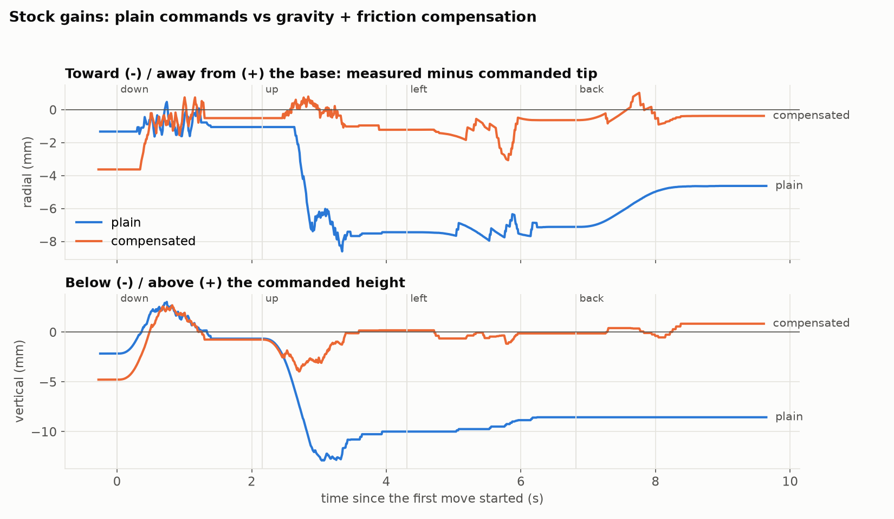

# Drift check with the base map

`tmp_scripts/comp_check.py`, stock gains, shoulder trim 41, compensation with the base map (`../230219_base_map_check/`). Same moves as `../224651_comp_check/` (down 20, up 20, 30 mm left, back).

| | inward shift during rise | after rise: radial / vertical | after return from the left: radial / sideways / vertical |
|---|---|---|---|
| plain, round 1 | −6.4 mm | −7.4 / −10.0 mm | −4.6 / 2.7 / −8.6 mm |
| plain, round 2 | −6.7 mm | −7.4 / −10.0 mm | −4.4 / 3.2 / −8.6 mm |
| **compensated, round 1** | **−0.7 mm** | **−1.2 / +0.2 mm** | **−0.4 / 0.8 / +0.8 mm** |
| **compensated, round 2** | **−1.3 mm** | **−1.3 / −0.1 mm** | **−0.7 / 0.8 / −0.5 mm** |
| *compensated, without the map (224651)* | *−1.0 / −1.4 mm* | *−1.0 / −0.1, −1.4 / −0.6 mm* | *−0.7 / 0.8 / −0.8 mm (both)* |

## Findings

- Same as without the map within ~0.5 mm: no inward drift on rising (~1 mm), vertical within 0.2 mm after rising.
- The sideways error after returning from the left is still 0.8 mm. In all four compensated trials of both runs the base ends at exactly +3 counts, even though the map changed the base command there by ~2 counts. On this slow return (30 mm at 15 mm/s), where the base stops doesn't follow the command. The base's stopping point seems to depend on approach speed (or the base settles into a preferred position), which a quick-move map can't capture. Next: measure the base band at the speeds the moves actually use.

Files: `summary.json`, `trials/*.npz`, `run.log`.
