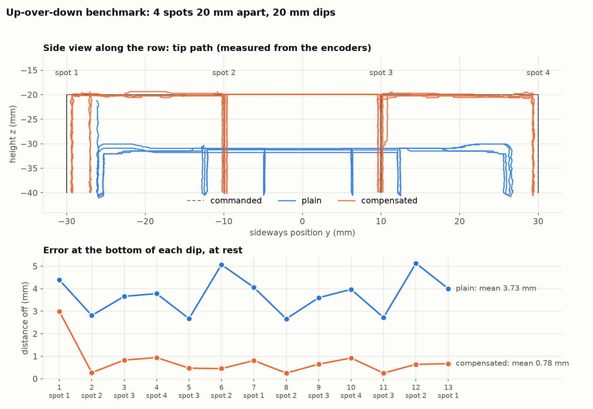

# Up-over-down benchmark, 2026-10-18 21:00

baseline: shoulder trim + refit + base map

Code 146d2ce+changes, compensation from `experiments/2026-10-17/230219_base_map_check`, shoulder trim 41.

| when | mode | change | bottom mean / worst | top mean / worst | repeat | path worst | inward worst | rough | code |
|---|---|---|---|---|---|---|---|---|---|
| 2026-10-18 21:00 | plain | baseline: shoulder trim + refit + base map | 3.73 / 5.13 | 13.74 / 14.37 | 3.80 | 16.07 | -6.22 | 10.6 | 146d2ce+changes |
| 2026-10-18 21:00 | comp | baseline: shoulder trim + refit + base map | 0.78 / 2.99 | 1.22 / 3.09 | 1.57 | 4.64 | -1.88 | 13.7 | 146d2ce+changes |

Files: `data.json` (scores, every dip), `trials/<mode>.npz` (telemetry + commanded path).

**Not in the history (start artifact):** compensated mode began where plain mode had left the base (~3 mm short) and went straight down, so the base's friction term had no direction yet: dip 1 is 3 mm off sideways and spot 1's repeat score is inflated. `scripts/benchmark.py` now does a lead-in (spot 2 → spot 1) before each mode. Rerun: `../210226_benchmark/`.
