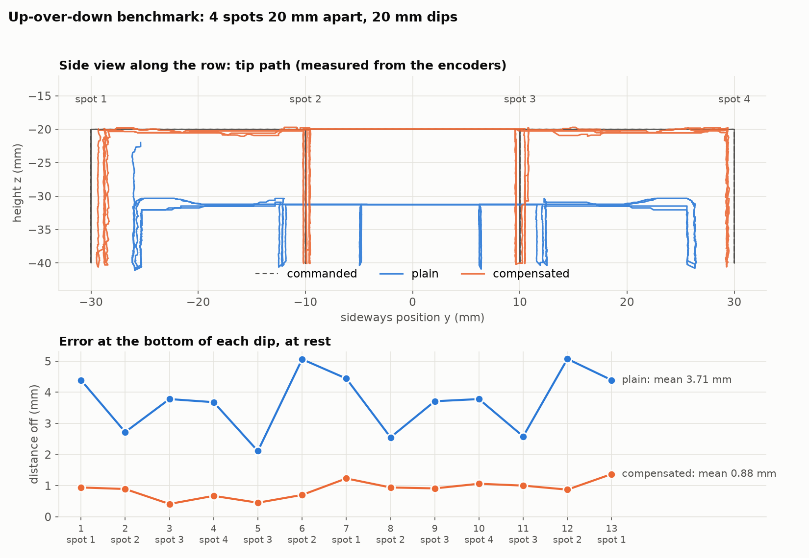

# Up-over-down benchmark, 2026-10-18 21:05

baseline: shoulder trim + refit + base map

Code 146d2ce+changes, compensation from `experiments/2026-10-17/230219_base_map_check`, shoulder trim 41.

| when | mode | change | bottom mean / worst | top mean / worst | repeat | path worst | inward worst | rough | code |
|---|---|---|---|---|---|---|---|---|---|
| 2026-10-18 21:05 | plain | baseline: shoulder trim + refit + base map | 3.71 / 5.07 | 13.69 / 14.41 | 3.86 | 15.82 | -6.27 | 10.5 | 146d2ce+changes |
| 2026-10-18 21:05 | comp | baseline: shoulder trim + refit + base map | 0.88 / 1.37 | 1.00 / 2.36 | 1.11 | 4.74 | -2.84 | 13.7 | 146d2ce+changes |

Files: `data.json` (scores, every dip), `trials/<mode>.npz` (telemetry + commanded path).

## Findings

- **Compensated:** every dip lands within 0.4–1.4 mm of where it should (mean 0.88). Plain lands 2–5 mm off, mostly sideways: the base stops short in whichever direction it came from.
- **Tops:** compensated is within ~1 mm after rising. Plain stays 11–12 mm low and 6.5 mm toward the base.
- **Inward pull on rising:** compensated is within ±0.9 mm on 12 of 13 rises (plain −4.7 to −6.3 mm). The exception is dip 6 (spot 2, arriving from spot 3): that rise stopped 2.8 mm inward (a joint stuck), and the identical dip 12 was fine (+0.1 mm). So it's occasional, not systematic. The "inward worst" score will catch it if it comes back.
- **Outer spots:** spots 1 and 4 land ~1 mm short towards the middle of the row (base angle ±9°, always arriving from the inside). This is the same slow-move base shortfall seen in `../../2026-10-17/230219_base_map_check/`.
- **Roughness:** compensated is ~30 % rougher (load wiggle 13.7 vs 10.5). The friction terms ramp in over the first 20 % of each move (~0.27 s), which kicks the joints at the start of every move. That's the next thing to smooth out.
