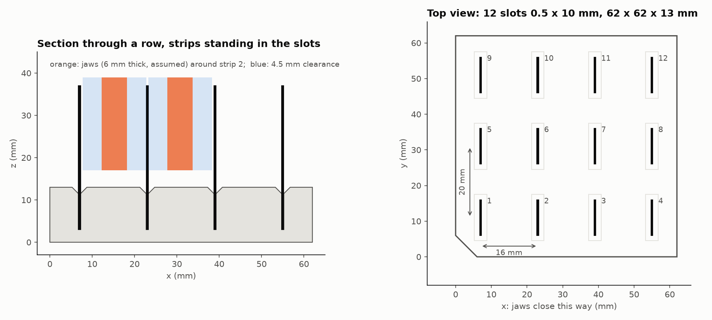

# SPE rack

Holds 12 screen-printed electrodes upright for the arm to pick: a 62 × 62 × 13 mm block with a 4 × 3 grid of 10 × 0.5 mm slots, 10 mm deep, each with a small lead-in funnel at the top. A strip 34 mm long stands 24 mm above the rack.



| File | |
|---|---|
| `spe_rack.stl` | the rack |
| `spe_slot_test.stl` | 40 × 20 mm coupon with the slot at clearance 0 / 0.1 / 0.2 / 0.3 / 0.4 mm (smallest at the chamfered end). **Print this first.** |
| `gcode/spe_slot_test_creality_PLA.gcode` | the coupon, sliced for any Creality: 47 min, 7.6 g PLA |
| `gcode/spe_rack_creality_PLA.gcode` | the rack, sliced for any Creality: 2 h 29 min, 27 g PLA |
| `creality_generic_pla.ini` | the PrusaSlicer 2.9 settings used for both |
| `spe_rack.json` | slot centres in the rack's frame (origin at the chamfered corner), for pick scripts |
| `make_rack.py` | regenerates all of the above; every dimension is a parameter at the top |

```
UV_CACHE_DIR=D:/.cache/uv uv run --with manifold3d --with trimesh python hardware/spe_rack/make_rack.py
```

## Why the slots are 16 mm and 20 mm apart

**Across the faces (x, the way the jaws close), 16 mm.** Each gap between two strips has to hold one jaw, with room for the jaw to be off target on both sides:

pitch ≥ strip 0.5 + jaw 6 + 2 × 4.5 = 15.5 → **16 mm**

**Along the width (y), 20 mm.** The jaw is wider than the strip. If it overhung the next row's strip, it would pinch two at once:

pitch ≥ strip 10 + overhang (20 − 10) / 2 + 4.5 = 19.5 → **20 mm**

The 4.5 mm per side comes from what we've measured, plus margins for what we haven't:

| Error source | mm | Basis |
|---|---|---|
| Arm, during the last 5 mm of the descent | 2.0 | worst case in the 2026-10-18 benchmark (encoders); 1.34 mm once at rest |
| Not seen by the encoders (link flex, geometry) | 1.0 | margin: never measured against a real reference yet |
| Where the rack sits | 1.0 | margin: taught by touching it with the arm, or found by the camera |
| Strip leaning in its slot | 0.5 | margin |
| **Total, per side** | **4.5** | worst cases added, not averaged |

4 × 3 at those pitches happens to come out square.

## Check before printing

1. **Measure the gripper.** Waveshare doesn't publish the jaw size, so `JAW_T = 6` (jaw-tip thickness) and `JAW_W = 20` (jaw width) are guesses. Measure the tips with calipers, change those two lines, and rerun. The pitch updates itself: an 8 mm jaw gives 18 mm.
2. **Print the slot coupon.** A 0.5 mm slot is about one nozzle wide on an FDM printer and usually comes out narrower. With no clearance, the strip will be a press fit the arm can't pull out. Find the coupon slot where a strip drops in and stands without wobbling, then set `CLEARANCE` to that value and rerun.
3. **Decide which end goes in the slot.** The slot rubs both faces of the part that's inside it. If the sensing end goes down (so the arm grips the connector end and can dip straight away), set `FACE_RELIEF = 1.0`. The slot then holds the strip only by its outer 1.5 mm edges and never touches the printed electrodes.

## Printing on a Creality

The G-code in `gcode/` works on any Creality FDM printer with a 220 mm or larger bed and a 0.4 mm nozzle (Ender-3 family, Ender-3 V3 / KE / SE, K1 / K1C / K1 Max, K2):

- **Commands:** only plain G-code that both Marlin and Klipper accept.
- **Placement:** the part sits at the bed centre (110, 110).
- **PLA:** 210 °C for the first layer, then 205 °C; bed 60 °C.
- **Layers:** 0.2 mm, 3 walls, 20 % gyroid infill.
- **Speeds:** conservative (25 mm/s outer walls), so the slots come out accurate.

To print:
- **Ender-3 family:** copy the file to the microSD card.
- **K1 / K2 / V3 KE:** upload it from the printer's web page or Creality Print, or use a USB stick.

Level the bed the way you normally do. The file uses the printer's saved bed mesh if it has one, and doesn't run its own probing.

If you find the model name (it's on the frame or in the screen's About/Info menu), the part can be re-sliced with that printer's own start code. Or open the STLs in Creality Print, pick your printer, and use the settings above. Regenerate the G-code after changing the STL:

```
D:/installations/PrusaSlicer-2.9.6/prusa-slicer-console.exe --datadir D:/installations/prusaslicer-data --export-gcode --load creality_generic_pla.ini --center 110,110 --output gcode/spe_rack_creality_PLA.gcode spe_rack.stl
```

## Use

- Print it as it sits (slots open at the top), no supports.
- Fix the rack down (tape, or a stop it pushes against) so it's always in the same place. Then teach its chamfered corner with the arm once; `spe_rack.json` gives every slot from there.
- Turn the gripper's roll so the jaws close along the rack's x axis.
- Grip near the top of the strip: the jaw tips need to stay above the rack's surface (the strip stands 24 mm above it).
